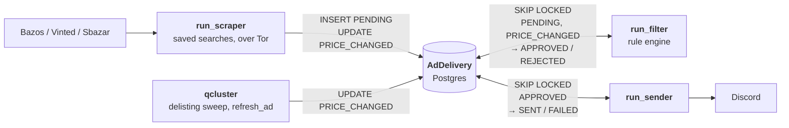
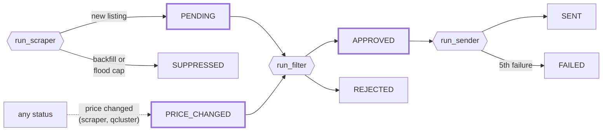

# Marketplace Scraper

[](https://github.com/jakub-kucera/marketplace-scraper/actions/workflows/test.yml)

A Django application that watches online marketplaces for new listings, filters them against
saved searches, and sends matches to Discord. Built around the Czech classifieds site
[Bazos.cz](https://bazos.cz), with a marketplace-abstraction layer extended to Vinted and Sbazar.

Built for personal, non-commercial market monitoring - not a commercial scraping service.

## What it does

- Polls saved searches (`Query` rows) against one or more marketplaces, routed through Tor for
  IP rotation.
- Detects new and price-changed listings and runs them through a configurable rule engine -
  price range, keywords, seller blocklist, location radius, price drops, and an optional price
  model.
- Delivers approved matches to Discord via webhook, with per-query routing and a periodic
  summary digest.
- Tracks delisting over time (`manage.py check_delisted`) - the only outcome signal the project
  has, used to judge how a listing's life ends.
- Optional, off by default per query: a linear price model scored against listing text, LLM-based
  spec extraction (Gemini/Anthropic, `NULL` provider with no key configured), and reference
  pricing pulled from Zboží.cz.

## Architecture

The pipeline is three long-running processes that never call each other. They coordinate through
one Postgres table, `AdDelivery`, used as a work queue: each row is one saved search's interest in
one listing, and its `status` column says which stage picks it up next.



Each stage owns its own transitions - the scraper only ever writes `PENDING` and never sends - so
a stage can crash, be redeployed or fall behind without the others noticing anything except a
longer queue. The thick boxes are the statuses a worker is waiting to pick up; the rest are final.



### How the queue behaves

- **Competing consumers.** Filter and sender claim a batch with `SELECT ... FOR UPDATE SKIP LOCKED`.
  A second worker skips rows the first has locked instead of waiting on them or processing them
  twice, so either stage scales by starting another copy. `of=("self",)` locks only the delivery
  row, not the `Query` and publisher rows joined in with it.
- **One transaction per batch.** Claim, decide, write the new status, commit. A crash mid-batch
  rolls back, and the rows return to the queue in the status they had - nothing is left half-done.
- **Idempotent enqueue.** A unique constraint on `(ad, query)` plus `get_or_create` means a listing
  seen on every pass is enqueued once per saved search, however many times it is scraped.
- **At-least-once delivery, on purpose.** The Discord POST happens inside the sender's transaction.
  If the process dies after Discord accepts the message but before the commit, the row is still
  `APPROVED` and is sent again. Exactly-once is not on offer - Discord's webhook API has no
  idempotency key - so the choice is between a rare duplicate and a rare lost alert, and a
  duplicate is cheaper.
- **Backpressure is not failure.** A 429 with `Retry-After` pauses that one channel by leaving it
  out of the next claim, without spending its retry budget; other channels keep sending. Errors
  with no `Retry-After` do count, and after 5 the delivery becomes `FAILED` and is announced in the
  logging channel.
- **The poll is an index scan.** Both pollers ask for `status IN (...) ORDER BY created LIMIT 50`,
  served by a composite `(status, created)` index.

Background jobs (`django-q2`: the delisting sweep, a pipeline watchdog, catalog syncs, log pruning,
on-demand enrichment from the admin) use the same Postgres as their broker.

### Why no message broker

RabbitMQ or Kafka is the textbook answer, and here it would make things worse:

- **The state already lives next to the data.** A delivery's status is written in the same
  database, under the same transactions, as the rows it describes. Put a broker in front and every
  stage has to write to the database *and* publish to the broker, which cannot be done atomically:
  a crash between the two either loses a message or announces one that was never committed. The
  standard fix is a transactional outbox - a table with a status column that a worker polls. That
  is this design, plus a broker to run.
- **The volume does not call for it.** New listings arrive in the hundreds to low thousands a day
  (the busiest day in August 2026 was ~6,500, during a backfill). Brokers are built for orders of
  magnitude more; Postgres serves this from one index.
- **It runs on a Raspberry Pi.** Every extra stateful service needs memory, monitoring, upgrades
  and its own backup. Today one `pg_dump` captures the listings and the queue together, and
  restoring it restores both, consistent with each other.
- **The queue is inspectable.** Every delivery stays a row with its outcome and `filter_reason`.
  "Why wasn't this ad sent?" is an admin page or one SQL query, not a consumed message that no
  longer exists.

What it costs: consumers poll instead of being pushed to, so a delivery can wait up to 30 s before
the filter sees it and 10 s before the sender does. That is small next to a 15-45 minute scrape
cycle, and Postgres `LISTEN/NOTIFY` would remove it without adding a broker. A broker starts
paying for itself when many independent consumers need the same events, when consumers live
outside this database, or when throughput outgrows an indexed table - none of which is true here.

The full architecture, data model, and every deliberate design decision (with the trap it avoids)
is written up in [`CLAUDE.md`](CLAUDE.md) - it is the primary reference for working in this
codebase, not just agent instructions.

## Stack

Django 5.2, Python 3.12, Postgres, Docker Compose, Tor (SOCKS proxy for IP rotation), django-q2
for background jobs, django-unfold for the admin theme, Poetry for dependencies.

## Getting started

```bash
poetry install
cp .env.sample .env        # SECRET_KEY has no default - everything else does

docker compose up -d postgres tor_proxy

python manage.py migrate
python manage.py create_sections
python manage.py create_categories

python manage.py runserver        # admin UI at /admin/
python manage.py run_scraper      # each in its own terminal
python manage.py run_filter
python manage.py run_sender
```

Or run the full stack - scraper, filter, sender, qcluster, the admin server, Postgres, Tor, and
Adminer - in Docker:

```bash
docker compose up -d
```

See [`CLAUDE.md`](CLAUDE.md) for the complete command reference, one-off management commands, and
every environment variable and its default.

## Testing

```bash
docker compose up -d postgres
pytest            # real Postgres, not SQLite - Postgres-only behavior is part of what's tested
ruff check .
mypy .
```

## Deployment

`.github/workflows/deploy.yml` deploys to a self-hosted runner on every pushed `v*` tag: build,
verify the built image, back up the database, migrate, restart.

```bash
git tag v1.2.3 && git push origin v1.2.3
```

## Documentation

- [`CLAUDE.md`](CLAUDE.md) - architecture, commands, the data model, and every deliberate design
  decision this codebase encodes.
- [`docs/`](docs/README.md) - research findings, shipped specs, and the open backlog, organized by
  lifecycle (`active` / `proposal` / `reference` / `shipped` / `superseded`) rather than by date.

## License

No license is granted. All rights reserved.
